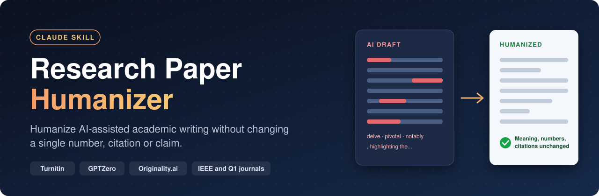
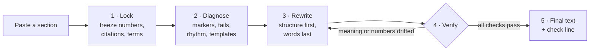

<p align="center">
  
</p>

<p align="center">
  <a href="LICENSE"></a>
  <a href="research-paper-humanizer/SKILL.md"></a>
  <a href="#-evidence-base"></a>
  <a href="https://github.com/noobarafat/research-paper-humanizer/stargazers"></a>
</p>

<p align="center">
  <b>Lower Turnitin, GPTZero and Originality.ai AI-detection scores on research papers<br>while keeping meaning, citations, technical terms and academic quality intact.</b>
</p>

<p align="center">
  <a href="#-installation">Install</a> ·
  <a href="#-how-it-works">How it works</a> ·
  <a href="#-before-and-after">Example</a> ·
  <a href="#-how-to-use">Usage</a> ·
  <a href="#-faq">FAQ</a>
</p>

---

## ✦ What it is

**Research Paper Humanizer** is an evidence-based [Claude](https://claude.ai) skill. It rewrites AI-assisted research papers so they read like an expert human author wrote them.

Generic "AI humanizers" add opinions, casual voice, typos or synonym swaps. In a research paper those changes damage quality and can be flagged as misconduct. This skill does the opposite. It applies the structural, discourse-level rewriting that corpus studies of LLM-written science show actually matters, and it keeps every fact frozen.

<table>
  <tr>
    <td align="center" width="25%"><h3>11</h3>rewrite levers,<br>structure first</td>
    <td align="center" width="25%"><h3>20+</h3>evidence-backed<br>AI marker words</td>
    <td align="center" width="25%"><h3>8</h3>paper sections<br>with playbooks</td>
    <td align="center" width="25%"><h3>0</h3>numbers, citations<br>or terms changed</td>
  </tr>
</table>

## ✦ Why it is different

| | Typical AI humanizer | **Research Paper Humanizer** |
|---|:---:|:---:|
| Freezes numbers, citations and technical terms | ❌ | ✅ |
| Keeps formal research register | ❌ | ✅ |
| Checks every claim for meaning drift | ❌ | ✅ |
| Never increases word count | ❌ | ✅ |
| Avoids typos, homoglyphs and invisible characters | ❌ | ✅ |
| No reliance on humanizer tools that Turnitin detects | ❌ | ✅ |
| Section-specific guidance (Abstract to Conclusion) | ❌ | ✅ |
| Guidance on disclosing AI use to IEEE and other publishers | ❌ | ✅ |

## ✦ How it works



**The levers, in priority order:**

| # | Lever | What changes |
|:-:|---|---|
| 1 | Information order | Each sentence opens with linking context and ends on the new result (Gopen and Swan) |
| 2 | Participle tails | ", highlighting X" becomes its own sentence (LLMs use these 2 to 5 times more) |
| 3 | De-nominalization | "performed the optimization of" becomes "optimized" |
| 4 | Voice by function | Passive for procedures, "we" for decisions |
| 5 | Sentence length | Short and long sentences mixed naturally (burstiness) |
| 6 | Paragraph shape | No repeated claim, citation, claim, citation template |
| 7 | Transitions | Moreover, Furthermore, Notably stacks removed |
| 8 | Hedging | Boosters replaced with evidence-calibrated hedges (Hyland) |
| 9 | Specificity | Vague phrases point to what the passage already names |
| 10 | Vocabulary | Marker words swapped last, for plain words |
| 11 | Lists to prose | Contribution lists rewritten as varied prose |

## ✦ Before and after

```diff
- In recent years, explainable artificial intelligence has garnered significant attention,
- playing a pivotal role in high-stakes domains. Notably, SHAP has emerged as a comprehensive
- framework for interpreting model predictions, highlighting the contribution of each feature.
- Furthermore, the integration of SHAP with gradient boosting enables a deeper understanding
- of complex decision processes, underscoring its potential for real-world deployment.
+ Explainable artificial intelligence has drawn significant attention and plays a central role
+ in high-stakes domains. SHAP has become a general framework for interpreting model
+ predictions. It assigns each feature a contribution. Paired with gradient boosting, it
+ clarifies how complex models reach decisions. This gives the combination potential for
+ real-world deployment.
```

<table>
  <tr>
    <th>Removed</th>
    <th>Kept exactly</th>
  </tr>
  <tr>
    <td>Generic opener "In recent years"<br>3 participle tails<br>2 stacked transitions<br>4 marker words (garnered, pivotal, comprehensive, underscoring)</td>
    <td>Every claim at the same strength<br>All technical terms<br>The hedge on "potential"<br>Word count: 57 down to 51</td>
  </tr>
</table>

## ✦ Installation

<details open>
<summary><b>Claude (web and desktop apps)</b></summary>

1. Download [`research-paper-humanizer.zip`](research-paper-humanizer.zip) from this repository.
2. Upload the zip in the Skills section of Claude's settings.
3. Make sure the skill is enabled.

</details>

<details>
<summary><b>Claude Code</b></summary>

```bash
git clone https://github.com/noobarafat/research-paper-humanizer.git
mkdir -p ~/.claude/skills
cp -r research-paper-humanizer/research-paper-humanizer ~/.claude/skills/
```

For a project-level install, copy the folder into `.claude/skills/` inside your project instead.

</details>

<details>
<summary><b>Other agents</b></summary>

The skill is a single Markdown file, [`research-paper-humanizer/SKILL.md`](research-paper-humanizer/SKILL.md). Any agent that supports Agent Skills, or any LLM given the file as instructions, can use it.

</details>

## ✦ How to use

Paste a section of your paper and ask Claude to humanize it, or call the skill by name:

```text
/research-paper-humanizer
<paste your Related Work section here>
```

By default you get the final rewrite, ready to paste, followed by one check line:

```text
Words: 214 -> 201 | Numbers, citations, terms: unchanged
```

| Mode | What it does |
|---|---|
| `audit` | Lists the remaining AI tells sentence by sentence, without rewriting |
| `native` | Writes the passage in your first language so you can translate it into English yourself |
| `check` | Fixes only factual and mechanical errors in text you wrote or translated |
| `trim to N` | Cuts the passage to N words or fewer with no content loss |

> [!TIP]
> Turnitin shows scores from 1% to 19% only as "*%". If your paper is stuck around 20%, send only the sentences Turnitin highlights instead of the whole section.

## ✦ Who it is for

1. Researchers, PhD students and master's students writing for **IEEE conferences, Q1 journals, Elsevier, Springer, ACM** and similar venues.
2. Non-native English academic writers. Detectors flag them more often because constrained, predictable prose looks "AI-like" (Liang et al., *Patterns*, 2023).
3. Anyone who drafts with ChatGPT, Claude or Gemini and wants the final paper to read as their own polished scholarly writing.

## ✦ What it will never do

> [!WARNING]
> These techniques are either detected, banned as misconduct, or both. The skill refuses all of them.

1. Use homoglyphs, zero-width or invisible characters, or white text.
2. Insert deliberate typos or grammar errors.
3. Swap synonyms for technical terms ("deep learning" never becomes "profound learning").
4. Run text through commercial humanizers or paraphrasers.
5. Use automated machine-translation round trips.
6. Fabricate data, citations, hedges or examples.
7. Advise hiding AI use where a venue requires disclosure.

## ✦ Ethics and AI disclosure

> [!IMPORTANT]
> This skill removes **false AI signals** from content the author owns and has verified. It does not replace your venue's AI-use policy.

| Publisher | Requirement |
|---|---|
| **IEEE** | Disclose AI-generated content in the Acknowledgments: system, sections and level of use |
| **Elsevier** | Separate generative AI declaration placed before the references |
| **ACM** | Full disclosure in the work when AI generates content |
| **Springer Nature** | Document LLM use; check the specific journal's guide |

The skill offers ready-to-adapt disclosure text at the end of a full-paper job.

## ✦ Evidence base

<details>
<summary><b>Show the 11 sources behind the rules</b></summary>

1. Kobak et al., "Delving into LLM-assisted writing in biomedical publications through excess vocabulary," *Science Advances*, 2025.
2. Liang et al., "Monitoring AI-Modified Content at Scale," *ICML* 2024; "Mapping the Increasing Use of LLMs in Scientific Papers," *COLM* 2024.
3. Reinhart et al., "Do LLMs write like humans? Variation in grammatical and rhetorical styles," *PNAS*, 2025.
4. Gopen and Swan, "The Science of Scientific Writing," *American Scientist*, 1990.
5. Hyland, hedging and metadiscourse in research articles, 1998 and 2005.
6. Swales, *Genre Analysis* (CARS model), 1990.
7. Krishna et al., *NeurIPS* 2023, and Sadasivan et al., *TMLR* 2025, on paraphrase attacks and diminishing returns.
8. Dugan et al., "RAID," *ACL* 2024.
9. Liang et al., "GPT detectors are biased against non-native English writers," *Patterns*, 2023.
10. Cabanac et al., "Tortured phrases," 2021.
11. Turnitin AI writing detection model release notes; IEEE PSPB Operations Manual 8.2.1.B.10.

</details>

## ✦ FAQ

<details>
<summary><b>Does this guarantee a 0% AI score?</b></summary>

No. Technical papers keep a floor because terminology cannot change. In practice, structural rewriting brings many papers from about 60% to about 20%. The skill then targets only the remaining flagged clusters.

</details>

<details>
<summary><b>Is humanizing a research paper allowed?</b></summary>

Improving the language of your own verified work is normal academic editing. What matters is following your venue's AI disclosure policy, which this skill supports.

</details>

<details>
<summary><b>Will it change my results or citations?</b></summary>

No. Numbers, citations, equations and terms of art are frozen, and every pass is checked for meaning drift.

</details>

<details>
<summary><b>Does it work with ChatGPT or Gemini drafts?</b></summary>

Yes. It works on any AI-assisted draft. The skill itself runs in Claude, or in any agent that supports Agent Skills.

</details>

<details>
<summary><b>Does it work for non-IEEE papers?</b></summary>

Yes. IEEE is the default citation style. The house style section lets you switch to your venue's rules.

</details>

---

<p align="center">
  Built by <b>K. M. Arafat Islam</b> · CSE, Daffodil International University, Dhaka<br>
  Research focus: explainable AI (SHAP, LIME) in socioeconomic domains
</p>

<p align="center">
  If this skill helps your paper, <a href="https://github.com/noobarafat/research-paper-humanizer">star the repo</a> so other researchers can find it.
</p>

<p align="center"><sub>Keywords: research paper humanizer · humanize AI text · AI humanizer for academic writing · reduce AI detection score · Turnitin AI detection · GPTZero · Originality.ai · iThenticate · academic writing · scientific writing · IEEE paper writing · Claude skill · Claude Code skill · Agent Skills · ChatGPT academic writing · research integrity · AI disclosure</sub></p>
